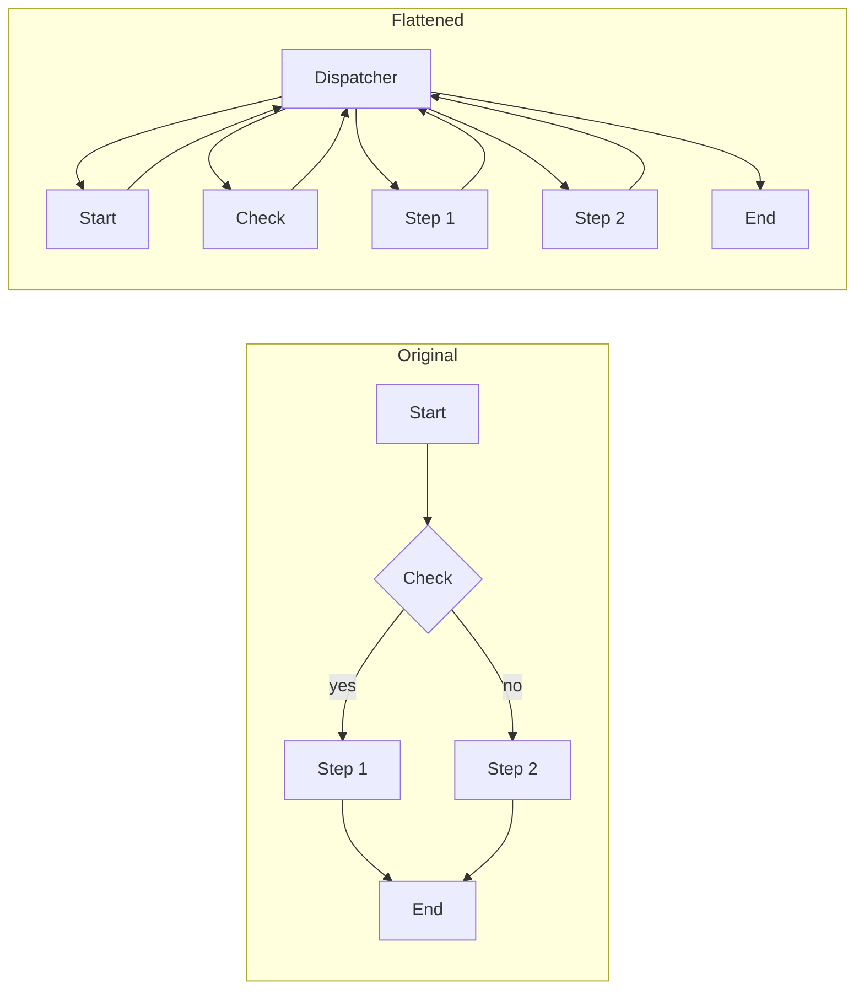

# CFF Deobfuscator

Recovers the original control flow of programs hidden by **control-flow
flattening (CFF)**, a technique used to slow down reverse engineering.

Built for my MSc Cybersecurity dissertation at the University of Manchester,
and now maintained as an open project.

## The problem

Flattening breaks a function into pieces and sends every piece through one
central "dispatcher", so the original logic is no longer visible.



This tool finds the dispatcher, works out which piece runs next, and rebuilds
the original connections.

## Results

Tested on Tigress-obfuscated x64 ELF binaries from the
[Quarkslab dataset](https://github.com/quarkslab/diffing_obfuscation_dataset),
compiled with `-O0`.

| | zlib (level 50) | sqlite |
|---|---|---|
| Functions tested | 69 | 1,199 |
| Dispatcher found | 59 (86%) | 920 (77%) |
| Recovered and compared | 58 | 801 |
| Within ±2, of those compared | 50 (86%) | 689 (86%) |
| **Within ±2, of all functions** | **50 (72%)** | **689 (57%)** |
| Exact match, of all functions | 16 (23%) | 248 (21%) |

- The pipeline was developed on zlib and run on sqlite with no code changes.
- Across zlib intensity levels 10–100 (level 20 unavailable), detection rises
  from 79% to 91%.
- At `-O2`, detection falls to 11% (about 7 of 61 functions). See
  [the investigation](o2_root_cause.md).

**How it's measured:** recovered cyclomatic complexity
(`edges - nodes + 2`) is compared with the unobfuscated version of the same
function. The two versions are compiled separately, so their blocks don't line
up exactly. Matching complexity suggests similar branching, but doesn't prove
the graphs are identical.

## How it works

| Stage | File | What it does |
|---|---|---|
| 1. Detect | `dispatcher.py` | Finds a block with unusually many incoming edges, then confirms it by resolving a real switch |
| 2. Resolve | `state_analysis.py` | Finds the state variable and each block's next value |
| 3. Rebuild | `cfg_recovery.py` | Reads the dispatcher's case table and reconnects the original blocks |
| 4. Evaluate | `batch_eval.py` | Compares the result with the unobfuscated function |

Stage 2 reads constants directly from the VEX intermediate representation, and
falls back to symbolic execution when the next value depends on data.

## Quick start

Requires **Python 3.10–3.12**. `angr` doesn't yet reliably support 3.13, and
takes several minutes to install.

**1. Install.** The folder name must be `cff_deobfuscator`, with an underscore.

```bash
mkdir cff && cd cff
git clone https://github.com/parvathaa/cff-deobfuscator.git cff_deobfuscator
python3.12 -m venv angr-env
source angr-env/bin/activate
pip install -r cff_deobfuscator/requirements.txt
```

**2. Get the dataset.** Its tool isn't on PyPI.

```bash
git clone https://github.com/quarkslab/diffing_obfuscation_dataset.git
pip install ./diffing_obfuscation_dataset
mkdir -p dataset
obfu-dataset-cli download-plain -r dataset/ -t 5 zlib
obfu-dataset-cli download-obfuscated -r dataset/ -t 5 -p zlib -o tigress -op CFF -l 50
```

**3. Run it** from the outer `cff` folder.

```bash
python3 -m cff_deobfuscator.cli --help
```

`cli.py` uses an earlier metric, so its scores differ from the results above.

<details>
<summary>Which warnings are normal?</summary>

- **`unicornlib.dylib` failed to load:** harmless, since it isn't used here.
- **`pattern extraction failed`** or **`no switch-signature block found`:** a
  candidate was checked and rejected, which is expected.

A Python traceback is a real error.

</details>

## Reproduce the results

Download every level or project a script needs first. Missing zlib levels are
skipped.

| Command | Results |
|---|---|
| `python3 -m cff_deobfuscator.regenerate_intensity_csv` | `batch_results_by_intensity.csv` |
| `python3 -m cff_deobfuscator.regenerate_sqlite_csv` | `sqlite_generalization_results.csv` |
| `python3 -m cff_deobfuscator.regenerate_o2_csv` | `o2_results.csv` |

## What I learned

- **Graph statistics alone weren't enough.** Some normal functions looked more
  flattened than real ones. Confirming an actual switch raised zlib detection
  from 43% to 86%.
- **Better numbers can be wrong.** An earlier 93% was inflated by return and
  call blocks being mistaken for switches. I fixed the bug and reported the
  lower number.
- **Optimization can undo the obfuscation.** In two `-O2` functions I inspected,
  much of the flattened structure was already gone.

Full details are in the [engineering notes](docs/engineering-notes.md).

## Limitations

- Validated only on Tigress. OLLVM is untested.
- Works best on `-O0` code.
- Handles flattening within one function, not across functions.
- If/else-chain dispatchers are implemented but untested, because no real
  sample was found.
- Some dispatchers are found but yield no usable case table, such as in
  `gzopen64`.

## Roadmap

- Compare against a simple baseline and break results down by function size
- Check block counts across all `-O2` functions
- Combine static analysis with dynamic tracing to recover values that depend on
  runtime input

## Credits

Binaries from Quarkslab's
[diffing_obfuscation_dataset](https://github.com/quarkslab/diffing_obfuscation_dataset).
Built with [angr](https://angr.io) and [NetworkX](https://networkx.org).
